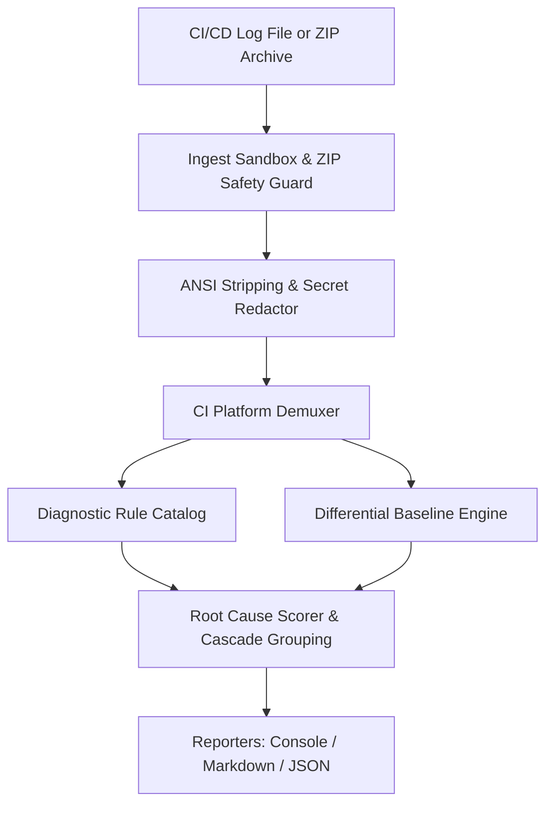

# CIAUTOPSY 🩺

**Find the first real failure, not the last 10,000 log lines.**

[](LICENSE)
[](https://www.python.org/downloads/)
[](#status)
[](#testing)

Diagnose failed CI/CD pipelines with evidence-based root-cause analysis. Identify critical errors, trace cascading failures, compare successful and failed builds, and generate actionable debugging reports—all locally, with no paid APIs required.

---

## 🔍 The Problem

When a continuous integration pipeline fails, modern CI runners emit tens of thousands of lines of noisy build output. Developers frequently encounter:
- **Cascading Distractions:** The true root cause (e.g. `ModuleNotFoundError` or `OOMKilled`) is buried at line 1,200, while the terminal highlights line 45,000: `Process exited with code 1`.
- **Hallucinated or Speculative Explanations:** Cloud-based LLM log tools often summarize logs without citing verifiable source line numbers or can inadvertently leak proprietary secrets.
- **Undetected Regressions:** Pinpointing what actually changed between the last successful build and the failed run requires manual, tedious scrolling.

**CIAUTOPSY** is a local-first, deterministic failure analysis engine. It links every diagnostic finding directly to 1-indexed source lines, suppresses cascading exit status noise, applies automated secret redaction, and diffs failed builds against known-good baselines.

---

## ⚡ Quickstart

### 1. Installation

Install directly using `pip`:

```bash
# From local source or built wheel
pip install .

# Or for development and benchmarking
pip install -e ".[dev]"
```

Verify the installation:

```bash
ciautopsy version
ciautopsy rules
```

---

### 2. Common Usage

#### Analyze a Failed Log (Terminal Summary)
```bash
ciautopsy analyze build_failed.log
```

#### Export Markdown Autopsy Report
```bash
ciautopsy analyze build_failed.log --format markdown --output autopsy_report.md
```

#### Export Machine-Readable JSON
```bash
ciautopsy analyze build_failed.log --format json --output autopsy_report.json
```

#### Differential Analysis against a Successful Baseline
```bash
ciautopsy analyze build_failed.log --baseline build_success.log --output comparison_report.md
```

#### Analyze a GitHub Actions Run Archive (`.zip`)
```bash
ciautopsy analyze workflow_run.zip --output autopsy_report.md
```

---

## 🖥️ Terminal Example

When analyzing a failed pipeline run, CIAUTOPSY prints an evidence-linked diagnostic summary:

```text
🩺 CIAUTOPSY v0.1.0 | CI/CD Failure Analysis
Target: examples/logs/failed_python_import.log (Platform: GitHub Actions)
Analyzed: 34 lines | Hypotheses: 1 | Cascades Grouped: 1

┌─ Leading Root Cause: DEP-001 ────────────────────────────────────────────────────────┐
│ Title: Missing Python dependency: jwt                                                │
│ Category: Dependencies | Severity: HIGH | Confidence: HIGH                           │
│ Details: Python failed to import module 'jwt' (ModuleNotFoundError).                 │
│ Evidence:                                                                            │
│   Line 9 [Run tests]: ModuleNotFoundError: No module named 'jwt'                     │
│ Suggested Actions:                                                                   │
│   • Check your pyproject.toml, setup.py, or requirements.txt for 'jwt'               │
│   • Add 'jwt' or 'PyJWT' to your dependency manifest                                 │
└──────────────────────────────────────────────────────────────────────────────────────┘

┌─ Cascading / Secondary Symptoms (1 grouped) ─────────────────────────────────────────┐
│ • [CAS-001] Step exit failure: Step exited with error code 1 (Line 29)               │
└──────────────────────────────────────────────────────────────────────────────────────┘
```

---

## 🏗️ Architecture & Data Flow



Detailed architectural specifications are available in [`docs/architecture.md`](docs/architecture.md).

---

## 🧩 Supported Diagnostic Rules

CIAUTOPSY v0.1.0 includes built-in rules across 7 core categories:

| Rule ID | Category | Severity | Detection Signature |
|---|---|---|---|
| `DEP-001` | Dependencies | `HIGH` | Python `ModuleNotFoundError: No module named '...'` / `ImportError` |
| `DEP-002` | Dependencies | `HIGH` | Python `pip` dependency conflicts (`ResolutionImpossible`) |
| `DEP-003` | Dependencies | `HIGH` | Node.js npm `ERESOLVE` dependency tree clash |
| `DEP-004` | Dependencies | `HIGH` | Node.js `Cannot find module '...'` (`MODULE_NOT_FOUND`) |
| `OOM-001` | Infrastructure | `CRITICAL` | Linux kernel OOM killer & Docker container exit 137 |
| `TIM-001` | Infrastructure | `CRITICAL` | CI execution timeout exceeded |
| `DSK-001` | Infrastructure | `CRITICAL` | Disk space exhausted (`No space left on device`) |
| `DOK-001` | Infrastructure | `HIGH` | Docker socket permission denied |
| `CMD-001` | Build | `HIGH` | Executable not found (exit code 127) |
| `BLD-001` | Build | `HIGH` | C/C++ compilation & missing header failure |
| `SYN-001` | Build | `HIGH` | Syntax error & indentation error |
| `CAS-001` | Build | `LOW` | Downstream secondary process exit (suppressed when primary cause is found) |
| `TST-001` | Testing | `HIGH` | Pytest assertion failures and regressions |
| `TST-002` | Testing | `HIGH` | Jest test suite failure |
| `SEC-001` | Secrets | `CRITICAL` | HTTP 401 Unauthorized / HTTP 403 Forbidden |
| `SEC-002` | Secrets | `HIGH` | Missing required environment variable |
| `NET-001` | Network | `HIGH` | DNS resolution failure & connection timeout |

For full rule details, see [`docs/supported-errors.md`](docs/supported-errors.md).

---

## 📊 Measured Synthetic Benchmark Results

CIAUTOPSY is tested continuously against an 11-case benchmark corpus containing positive failures, negative controls (clean builds), and unmodeled/ambiguous logs.

Run the reproducible benchmark at any time:

```bash
python scripts/run_benchmark.py
```

### Measured Performance (Python 3.10–3.14)
- **Top-1 Root Cause Accuracy:** `100.0%` (9/9 positive cases)
- **Top-3 Candidate Recall:** `100.0%` (9/9 positive cases)
- **Exact Evidence Line Accuracy:** `100.0%` (9/9 cited exact 1-indexed source line)
- **Negative Control False-Positive Rate:** `0.0%` (0/1 clean build falsely flagged)
- **Unknown Case Handling:** `100.0%` (1/1 unmodeled failure reported honestly without speculation)
- **Average Latency:** `0.48 ms` per log
- **Peak Memory:** `136.6 KB`

*Methodology and metric definitions are documented in [`docs/benchmark-methodology.md`](docs/benchmark-methodology.md).*

---

## 🔒 Security & Privacy Model

CIAUTOPSY is built to inspect untrusted logs safely:
- **Zero Cloud Transmission:** Analysis runs 100% locally. Zero telemetry, zero external APIs.
- **Safe ZIP Ingestion:** Rejects path traversal attacks (`..`, absolute paths, drive letters), member count limits (max 200), file size limits (max 50 MB), and zip-bomb compression ratios (>100:1).
- **Automated Secret Redaction:** Heuristically masks GitHub tokens, AWS access keys, Bearer tokens, passwords in URLs, database connection strings, and private key blocks before displaying or saving reports.
- **Non-Execution Guarantee:** CIAUTOPSY will never execute shell commands or endpoints found in logs.
- *Caveat:* Pattern-based redaction is best-effort. Users must verify reports before public distribution.

For full threat boundaries, see [`docs/security.md`](docs/security.md) and [`docs/privacy.md`](docs/privacy.md).

---

## 🧪 Testing

The repository contains 48 automated tests covering unit, integration, CLI, and archive security checks:

```bash
# Run pytest with code coverage
pytest --cov=ciautopsy --cov-report=term-missing

# Run linter & formatter checks
ruff check .
ruff format --check .

# Static type checking
mypy src/ciautopsy
```

---

## 📖 Documentation Directory

- [Architecture & Data Flow](docs/architecture.md)
- [Supported Error Catalog](docs/supported-errors.md)
- [Security Architecture](docs/security.md)
- [Privacy & Secret Redaction](docs/privacy.md)
- [Configuration & CLI Options](docs/configuration.md)
- [JSON Report Schema v0.1.0](docs/json-schema.md)
- [Benchmark Methodology](docs/benchmark-methodology.md)
- [Contributing Diagnostic Rules](docs/contributing-rules.md)
- [Troubleshooting & FAQ](docs/troubleshooting.md)
- [Release Process](docs/release-process.md)

---

## 🗺️ Project Roadmap

- [x] Evidence-linked root cause analysis engine
- [x] Cascading failure grouping and secondary error suppression
- [x] Baseline differential comparison (`--baseline`)
- [x] Safe ZIP archive ingestion with zip-bomb & traversal defense
- [x] Automated secret redaction
- [x] Multi-format output: Console, 10-section Markdown, Schema-validated JSON (`v0.1.0`)
- [x] 48 automated tests (93% code coverage)
- [x] Reproducible synthetic diagnostic benchmark
- [ ] Native GitHub Actions Step Summary Action
- [ ] GitLab CI & CircleCI native archive adapters
- [ ] SARIF report exporter

---

## 🤝 Contributing

Contributions, feedback, and sample failure logs are welcome! Please read [CONTRIBUTING.md](CONTRIBUTING.md) and [docs/contributing-rules.md](docs/contributing-rules.md) before submitting pull requests.

---

## 📄 License

CIAUTOPSY is open-source software licensed under the [MIT License](LICENSE).
