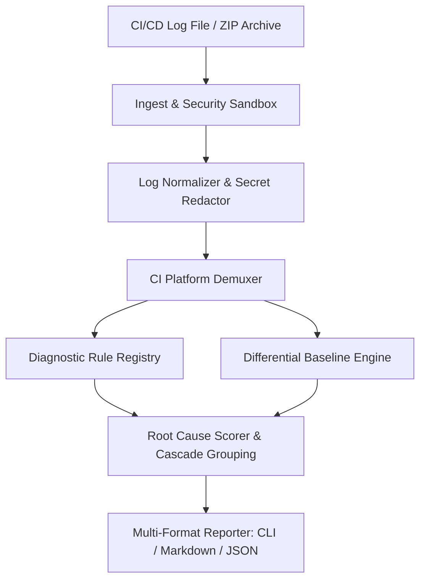

# CIAUTOPSY Architecture & Pipeline

CIAUTOPSY is built around an evidence-first, deterministic pipeline designed to diagnose continuous integration and continuous delivery (CI/CD) failures locally without external network dependencies or paid LLM APIs.

---

## 1. High-Level Data Flow

---

## 2. Pipeline Stages

### Stage 1: Ingestion & Archive Security Sandbox (`ciautopsy.ingest`)
- **File Reader:** Ingests raw UTF-8 / ASCII log files with fallback replacement for non-decodable bytes.
- **ZIP Archive Guard:** If a `.zip` archive is provided (e.g. GitHub Actions workflow run artifact):
  - Validates member filenames against path traversal attacks (`..`, absolute paths, drive letters).
  - Enforces bounds on member count, compressed size, uncompressed member size, and maximum compression ratios (rejecting compression bombs).
  - Streams selected log files without extracting dangerous files to the host disk.

### Stage 2: Normalization & Secret Redaction (`ciautopsy.parsers.normalizer` & `ciautopsy.security`)
- **ANSI Escape Stripping:** Strips VT100 terminal control sequences, color codes, and carriage return overwrites (`\r`).
- **Secret Redaction:** Redacts GitHub tokens, AWS keys, Bearer tokens, credentials in URLs, and private key blocks *prior* to evidence extraction and report rendering.
- **Timestamp & Line Tracking:** Preserves the exact 1-indexed original source line number for every line ingested.
- **Line Length Truncation:** Caps lines at 8,192 characters to mitigate Regular Expression Denial of Service (ReDoS).

### Stage 3: Step Demuxing (`ciautopsy.parsers.demuxer`)
- Detects the CI runner platform (GitHub Actions, GitLab CI, or Generic).
- Extracts group headers (`##[group]...`, `section_start:...`) and tracks the active pipeline step name.

### Stage 4: Diagnostic Rule Matching (`ciautopsy.rules`)
- Modular rules register fast keyword pre-filters and compiled regex patterns.
- Evaluates lines against candidate rules across 7 core categories:
  - Dependencies & Modules
  - Infrastructure, Memory & Timeouts
  - Build & Compilation
  - Testing & Assertions
  - Secrets & Environment
  - Network & Connectivity
  - Cascading Exit Codes

### Stage 5: Root-Cause Scoring & Cascade Suppression (`ciautopsy.engine.analyzer`)
- Distinguishes **primary triggers** (such as `ModuleNotFoundError` or `OOMKilled`) from **secondary symptoms** (such as `Process exited with code 1`).
- Cascading symptoms are grouped under the primary failure rather than cluttering the report as separate root causes.
- Computes transparent confidence levels (`HIGH`, `MEDIUM`, `LOW`) based on signature specificity, step context, and supporting evidence.
- Retains alternative hypotheses when ambiguity cannot be resolved deterministically.
- Flags missing evidence (e.g., truncated logs or missing exit codes).

### Stage 6: Baseline Differential Comparison (`ciautopsy.comparison`)
- When a `--baseline <successful.log>` is supplied, compares error events and pipeline steps between runs.
- Identifies newly introduced failures versus persistent warnings.

### Stage 7: Reporting (`ciautopsy.reports`)
- Formats structured findings into:
  - **Console:** Rich colored terminal display with tables, panels, and graceful ANSI fallback.
  - **Markdown:** Standardized 10-section autopsy report.
  - **JSON:** Strictly validated machine-readable format conforming to `schema_version: "0.1.0"`.
